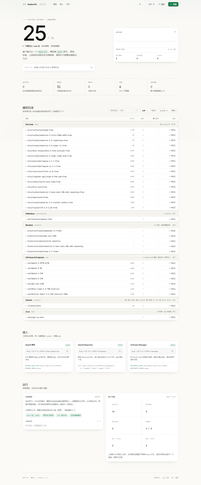

<h1 align="center">Keyless LLM Gateway</h1>

<p align="center">
  
  
  
  
</p>

<p align="center">
  <a href="#快速开始">快速开始</a> ·
  <a href="#为什么做这个">为什么做这个</a> ·
  <a href="#只在免鉴权场景有意义">只在免鉴权场景有意义</a> ·
  <a href="#接口">接口</a> ·
  <a href="#客户端">客户端</a> ·
  <a href="#来源">来源</a> ·
  <a href="#auto-模型自动调度失败自动换模型">auto 模型</a> ·
  <a href="#自动化agent-搜索脚本验证">自动化</a> ·
  <a href="#模型命名">模型命名</a> ·
  <a href="#web-控制台">Web 控制台</a> ·
  <a href="#实现">实现</a> ·
  <a href="#配置">配置</a> ·
  <a href="#安全">安全</a> ·
  <a href="#故障排查">故障排查</a> ·
  <a href="#卸载">卸载</a>
</p>

把**不需要 API key**的免费模型来源聚合成一个本地网关：改一个 `base_url` 就能用，任何 OpenAI / Anthropic / Responses 兼容的客户端都能接。

免鉴权免费模型在 2026 年确实可用，但它们**分散、命名各异、且随时会死**。本项目提供的是一个**可执行的网关**：一个入口、自动发现各来源的模型、跨来源失败转移，而不是一份会过期的清单。清单的维护全部跑在 GitHub Actions 上，你不需要在本地做任何事。

## 快速开始

需要 Windows 10/11、PowerShell 5.1+、Node.js 22+。两条命令跑起来：

```powershell
cd C:\workspace\keyless-llm
.\launch.ps1               # 启动；窗口开着就在跑，关窗即停
```

启动器把网关拉起来后**自动在浏览器打开 Web 控制台**（`http://127.0.0.1:8788/`）。可选：

```powershell
.\launch.ps1 -Port 8799    # 换端口
node server.mjs            # 只跑网关，不自动开浏览器
.\launch.ps1 -NoOpen       # 起了网关但不开浏览器
```

桌面快捷方式：

```powershell
python scripts/make_lnk.py   # 生成 C:\Users\<你>\Desktop\keyless-llm.lnk
```

## 为什么做这个

现在能用的免鉴权来源（2026-10-25 实测）：

| 来源           | 端点                            | 免费模型 | 可用 | 限流           |
| ------------ | ----------------------------- | ---- | -- | ------------ |
| Kilo Code    | `api.kilo.ai/api/gateway`     | 16   | 12 | 200 次/小时/IP  |
| Pollinations | `text.pollinations.ai/openai` | 1    | 1  | 4 次/分钟       |
| BlockRun     | `blockrun.ai/api/v1`          | 5    | 4  | IP 限流，免费容量常满 |
| OVHcloud     | `oai.endpoints.kepler.ai.cloud.ovh.net/v1` | 7 | 新增，待巡检 | 2 次/分钟/IP/模型 |

合计 **4 个启用来源、29 个免费模型**，其中 beam-free 等支持 1M 上下文。这些模型是 `gpt-oss`、`nemotron-3-ultra`、`beam-free`、`north-mini-code` 这类开源权重模型，跑在 NVIDIA、Poolside、Cohere 等基础设施上。另有 2 个来源（pollinations-gen、opencode）停用观察中，见[来源](#来源)。

问题在于它们不能直接拼在一起用：

|        | 直连各来源                                                                           | 用本项目                |
| ------ | ------------------------------------------------------------------------------- | ------------------- |
| 接入     | 每个来源一套 base_url、一套模型名、一套 header                                                 | 一个 `base_url`，模型名统一 |
| 模型发现   | 自己去翻每个来源的 `/models`                                                             | 网关自动拉取并合并           |
| 名字     | Kilo 是 `nvidia/xxx:free`，Pollinations 是 `tier: anonymous`，OpenCode 是 `xxx-free` | `<来源>/<模型>`，或裸名自动匹配 |
| 某个模型挂掉 | 自己重试、换模型                                                                        | 同来源内换模型 → 跨来源转移     |
| 谁还活着   | 只能逐个试                                                                           | 控制台一屏看清  |

更要命的是**它们会死**。2026 年内 Qwen Code 免费 OAuth（4/15 停）、Gemini CLI 免费层（6/18 停）、GitHub Models（关停）、Cerebras（转 30 天试用）、Roo Code（关闭）、Continue（停更）——包括本项目最早对接的 OpenCode 匿名通道，也已从 429 恶化为整体关闭。

这不是把 `curl` 包一层。真正的工作量在**按来源隔离的冷却状态机**（429 退避、403 拉黑、冷却到期重试）、**跨来源调度**、**协议翻译**和**额度感知**上。

## 只在免鉴权场景有意义

本项目只服务「**完全不需要 API key、不需要注册账号**」的公开通道。这带来三个必须知道的边界：

- **额度按 IP 共享**，不是按你个人。同一出口 IP 下的所有人共用池子，重度用户会把额度打光。
- **请求次数比 token 更稀缺**。Kilo 匿名 200 次/小时是**请求数**配额，探测和实际调用共用它。
- **上游随时可以收紧**。政策一变就 429 或 403，且不会提前通知。

它适合个人开发、试用、离线实验、给 Agent 找一个不花钱的兜底。**不适合当作生产依赖**，也不适合承载不能外泄的代码——这些来源都声明提示词可能被记录或用于训练。

## 接口

三套协议共用一个端口，模型发现走标准端点。

| 协议                      | 本地地址                       | 说明                             |
| ----------------------- | -------------------------- | ------------------------------ |
| OpenAI Chat Completions | `http://127.0.0.1:8788/v1` | 含流式与工具调用                       |
| Anthropic Messages      | `http://127.0.0.1:8788`    | 完整事件流（`content_block_delta` 等） |
| OpenAI Responses        | `http://127.0.0.1:8788/v1` | —                              |

API Key 填 `sk-keyless-local`（本地自设，仅用于挡本机其它程序）。上游侧**不需要任何 key**。想换一把就设 `KEYLESS_KEY`，控制台的接入区会显示当前该填什么。

`GET /v1/models` 列出全部可调度模型，带 `provider` 字段标明来源。

## 客户端

本项目不重写各客户端的配置文档，只把 base URL 换成本地地址即可。

| 客户端                                  | 改哪个字段                        | 值                                           |
| ------------------------------------ | ---------------------------- | ------------------------------------------- |
| Claude Code                          | `ANTHROPIC_BASE_URL`         | `http://127.0.0.1:8788`                     |
| Codex CLI                            | `base_url`                   | `http://127.0.0.1:8788/v1`                  |
| OpenCode                             | `options.baseURL`            | `http://127.0.0.1:8788/v1`                  |
| Cline / Roo Code                     | OpenAI Compatible 的 Base URL | `http://127.0.0.1:8788/v1`                  |
| Aider                                | `OPENAI_API_BASE`            | `http://127.0.0.1:8788/v1`                  |
| Continue                             | `apiBase`                    | `http://127.0.0.1:8788/v1`                  |
| Cherry Studio / LM Studio / NextChat | 自定义 OpenAI 供应商的 Base URL     | `http://127.0.0.1:8788/v1`                  |
| pi / DeepSeek Harness                | `models.json` 里的 `url`       | `http://127.0.0.1:8788/v1/chat/completions` |

### 三个会踩的坑

**OpenCode 的模型 id 不能带斜杠。** 它用 `provider/model` 寻址，斜杠会被当层级分隔符。正确做法是：provider 名填 `keyless`，model 填**不带来源前缀**的名字（如 `beam-free`），拼出来正好是 `keyless/beam-free`。不要在 model 里再写 `kilo/xxx`。

**reasoning 模型会先吃掉 token。** `beam-free`、`nemotron` 系列会输出思考内容，`max_tokens` 给小了会拿不到正文（表现为 `stop_reason: max_tokens` 但内容为空）。这类模型给到 1024 以上——OVHcloud 的 reasoning 模型尤其如此。

**模型名尽量写全。** 网关支持裸名匹配（`beam-free` → `kilo/reflection/beam-free`），但同名模型出现在多个来源时会有歧义，此时用完整的 `<来源>/<模型>`。

## 来源

来源定义全部在 `providers.json`，改这个文件就能加新来源，不用动代码。

| id             | 端点                            | 免费判定                  | 说明                      |
| -------------- | ----------------------------- | --------------------- | ----------------------- |
| `kilo`         | `api.kilo.ai/api/gateway`     | id 以 `:free` 结尾       | 200 次/小时/IP，模型最多        |
| `pollinations` | `text.pollinations.ai/openai` | `tier == "anonymous"` | 4 次/分钟，匿名 tier 只剩 1 个模型 |
| `blockrun`     | `blockrun.ai/api/v1`          | id 以 `nvidia/` 开头     | 免费容量经常打满，返回 503         |
| `ovh`          | `oai.endpoints.kepler.ai.cloud.ovh.net/v1` | `staticModels` 手工收录 | 2 req/min/IP/模型，匿名层，欧盟节点。只收对话模型——embedding/TTS/内容安全分类器一律不收 |
| `vireonix`     | `vireonix.ai/v1`              | `staticModels` 手工收录 | 免 key 免账号，唯一模型 `auto`（1M ctx 路由），20M 入/200K 出 tokens 每小时每 IP |
| `chat`         | `ch.at/v1`                    | `staticModels` 手工收录 | 免 key OpenAI 兼容代理，接受任意模型名；`/models` 是假的（把请求也当聊天），只能静态声明 |
| `pollinations-gen` | `gen.pollinations.ai/v1`  | 全部                    | **已停用**：匿名额度极小，耗尽后 401，恢复前不启用 |
| `opencode`     | `opencode.ai/inference/v1`    | id 含 `-free`          | **已停用**，匿名额度整体 429      |

各来源的免费模型 id 规则完全不同（`:free` 后缀 / `tier` 字段 / 自由价），所以用 `freeRule` 区分，不要硬编码模型名。

## 来源协议适配

对外，网关永远说标准协议（OpenAI Chat / Anthropic Messages / OpenAI Responses）；对内，每个来源说什么协议由 `providers.json` 里的 `api` 字段声明，网关负责双向转换：

| 上游 `api` 值 | 上游路径 | 转换内容 |
| --- | --- | --- |
| `openai-completions`（默认） | `/chat/completions` | 直通，零转换 |
| `anthropic-messages` | `/messages` | system 提取、content blocks ↔ message、thinking ↔ reasoning_content、tool_use ↔ tool_calls、SSE 事件流互转 |
| `openai-responses` | `/responses` | messages ↔ input、output_text 增量 ↔ chunk delta、usage 字段映射 |

客户端永远只学一种协议，来源爱说什么就说什么。加一个只说 Anthropic 协议的来源只需两行：`"api": "anthropic-messages"` + 它的 base 地址。


## auto 模型：自动调度，失败自动换模型

免鉴权来源最大的问题是**可用性是动态的**：客户端写死 `beam-free`，那个模型一旦被限流，整条链路就断了，只能干等冷却。

所以网关提供了一个伪模型 `auto`——把「选模型」这件事交给网关，调用方只关心「能不能通」：

```bash
curl http://127.0.0.1:8788/v1/chat/completions \
  -H "Authorization: Bearer sk-keyless-local" -H "Content-Type: application/json" \
  -d '{"model":"auto","messages":[{"role":"user","content":"hi"}],"max_tokens":50,"stream":false}'
```

响应体里的 `model` 字段会被替换成**实际选中的模型**（如 `kilo/reflection/beam-free`），响应头 `x-keyless-model` 也会带上，方便排查。

### 谁能进 auto 池

不是所有免费模型都配得上 `auto` 这个名字——64k 上下文的小模型、没有工具调用能力的模型，接进 Agent 里只会坏事。所以 auto 有**质量准入**：上下文 ≥ 256000（`KEYLESS_AUTO_MIN_CTX`，默认 256k）且未确认缺工具能力（`KEYLESS_AUTO_REQUIRE_TOOLS`，默认开启）。

判定规则刻意留了余地：

- 上下文**已知**小于 256k → 排除（如 `liquid/lfm-2.5-2.6b:free`，64k）
- **确认**没有工具调用 → 排除（如 `nemotron-3.5-content-safety:free`，内容安全分类器）
- 上下文 200k 的 `openrouter/free` 同样进不了池子
- ctx / tools **未知**的不误杀，靠评分降权
- 合格池为空时**降级放行全量**——宁可调度到弱模型，也不让 auto 直接失败

被排除的模型通过显式模型名仍然可以访问，auto 只是不再自动选它们。

### 怎么选、怎么重试

`auto` 对每个可用模型打分取最高：健康状态（`healthy` ≫ `unknown` ≫ `limited`）> 实测 TPS/TTFT > 上下文长度 > 确认支持 tools 加分 > 冷却剩余（负分）> 空闲时长（轻微正分，避免单模型被反复消耗）。

失败时**换一个模型继续试**，最多 `KEYLESS_AUTO_ATTEMPTS`（默认 6）次：

- `429` / `403` / `5xx` / 网络错误 → 换模型重试
- **HTTP 200 但内容为空** → 也算失败，换模型重试
- auto 模式单请求超时 `KEYLESS_AUTO_TIMEOUT`（默认 45s），宁可快速失败换下一个，也不卡死在不响应的上游上

「200 但空内容」这条是实测踩出来的：推理型模型（gpt-oss、step-3.7 等）会把 `max_tokens` 全烧在 reasoning 上，`finish_reason=length` 而正文一个字都没有。对调用方来说这是「成功但没结果」，比报错更难排查。

### 防限流

免鉴权额度普遍按 IP 计，最常见的翻车方式是**自己打爆自己**。网关内置三层防线：

- **同来源并发闸**：单来源在途请求默认不超过 `KEYLESS_PROVIDER_CONCURRENCY`（3），超出的排队、队列满则换模型——流式长响应不占额度（闸只罩到响应头）
- **尊重 Retry-After**：上游 429 带 `Retry-After` 头时按它冷却，没有才用默认的 `KEYLESS_CD429`（600s）
- **冷却自动转移**：429/403/5xx 的模型自动进冷却，调度时跳过，冷却结束自动恢复

### 相关配置

| 环境变量 | 默认 | 说明 |
| --- | --- | --- |
| `KEYLESS_AUTO_NAMES` | `auto,auto-fast,auto-thinking` | 识别为 auto 的模型名（多个等价于同一个策略） |
| `KEYLESS_AUTO_ATTEMPTS` | `6` | 最多试几个模型 |
| `KEYLESS_AUTO_TIMEOUT` | `45000` | auto 单模型超时（毫秒） |
| `KEYLESS_AUTO_MIN_CTX` | `256000` | auto 准入的最低上下文 |
| `KEYLESS_AUTO_REQUIRE_TOOLS` | `1` | 要求工具调用能力，`0` 关闭准入 |
| `KEYLESS_AUTO_STICKY` | `1` | 记住上次成功的模型并优先复用（减少切换开销） |
| `KEYLESS_PROVIDER_CONCURRENCY` | `3` | 单来源最大在途请求数（防自己打爆自己的配额） |
| `KEYLESS_TIMEOUT` | `120000` | 普通（非 auto）请求的上游超时 |
| `KEYLESS_ATTEMPTS` | `2` | 指定具体模型时的最大转移次数 |

## 自动化：agent 搜索，脚本验证

免鉴权来源会死得很快——2026 年内 Qwen Code、Gemini CLI 免费层、GitHub Models、Cerebras 免费层、Roo Code、Continue 接连关停。清单靠人维护必然过期，所以这个仓库把维护拆成**两层**：

| 层         | 干什么                                   | 用什么                | 为什么是它                    |
| -------- | ------------------------------------ | ------------------ | ------------------------ |
| **发现**    | 世界上又出现了哪些新的免鉴权服务                  | **agent**（LLM + 搜索） | 搜索是语义判断：要读文档、猜 API 路径、辨别「真免鉴权」还是「藏了注册墙」、评估合规性。脚本写不出这些规则，只会产出一堆假阳性。 |
| **验证**    | 候选来源到底能不能免鉴权                       | **脚本**（确定性实测）      | 不带任何鉴权头发请求，看是否真能拿到 200 和真实文本。可复现、不烧额度、能当 PR 硬门禁。 |

这条分界线是整个自动化的设计核心：**agent 只负责提候选，判定权交给实测**。三条链路：agent 发现（每日搜索 → 候选清单归档）→ 脚本验证（不带鉴权头实测，兼作 PR 硬门禁）→ 脚本巡检（每日探测已登记来源，快照自动提交）。

维护全部在 GitHub Actions 上跑，本仓库**没有本地定时任务**：

| workflow            | 触发                                | 作用                                     |
| ------------------ | --------------------------------- | -------------------------------------- |
| `probe.yml`        | 每日 UTC 3:17 + 改 `providers.json` 时        | 探测全部来源，自动提交 `snapshots/status.json` |
| `discover.yml`     | 每日 UTC 4:23（**零配置**，`GITHUB_TOKEN` 即可）   | agent 搜索新来源 → 候选清单 → 实测        |
| `validate-source.yml` | 改动 `providers.json` 的 PR        | **硬门禁**：新增来源必须通过免鉴权实测，不通过就 fail |

### 用法

**手动探测**（本地随时跑）：

```bash
node scripts/probe-sources.mjs          # 探测所有来源，写 snapshots/status.json
node scripts/validate-source.mjs --base https://example.com/api/v1 --model xxx
```

`validate-source.mjs` 的三态判定：

| 判定            | 含义                                | 是否收录         |
| ------------- | --------------------------------- | ------------ |
| `keyless`     | 匿名拿到真实生成，确实不要 key                | 收录           |
| `limited`     | 返回 429 —— 仍是免鉴权来源，只是当下配额/频率受限   | 收录，标注受限   |
| `not-keyless` | 401 / 403 / 返回 200 但内容不是模型生成         | 拒绝           |

429 判成 `limited` 而不是 `not-keyless` 是个刻意的区分：前者说明「不需要 key」这件事成立，只是此刻没额度；后者说明它根本不是免鉴权来源。

`discover.yml` 零配置可跑：CI 的 agent 优先用网关自举，不通就自动降级到 GitHub Models（内置 `GITHUB_TOKEN`），最后还有纯规则提取兜底。

**加一个新来源的完整流程**：

```bash
# 1. agent 搜索，或手工找到候选，产出候选清单
node scripts/discover-with-agent.mjs        # 或直接编辑 candidates.json

# 2. 实测候选是不是真免鉴权
node scripts/validate-source.mjs --file candidates.json

# 3. 通过的才写进 providers.json，然后用 PR 提交
#    → validate-source.yml 会自动实测校验，不通过就卡住
```

<details>
<summary>为什么 CI 上网关不一定可用（以及 discover 的 LLM 后端降级链）</summary>

`discover.yml` 里的 agent 按以下优先级选 LLM 后端，**前一档不通就自动降级**：

| 档位 | 后端 | 特点 |
| --- | --- | --- |
| ① | **本项目自己的网关** `model=auto` | **自举**：先起网关，用聚合来的免费模型维护聚合清单，零成本 |
| ② | **GitHub Models**（`GITHUB_TOKEN`） | `permissions: models: read` + 内置 token，**零配置、无 secret、免费** |
| ③ | 纯规则提取 | 完全不用 LLM，从搜索结果里按特征挑 URL |

为什么需要第 ② 档——GitHub Actions 是**共享出口 IP**：

- 免费来源普遍按 IP 限流（Kilo 200 次/小时/IP），Runner 的 IP 段被无数项目共用，网关不一定通
- 数据中心 IP 更容易被 DuckDuckGo / Bing 反爬拦截
- 所以网关是首选，但不能是唯一

**CI 上网关到底能不能用？** 这个问题没有理论答案，取决于 Runner 抽到哪个 IP。`discover.yml` 内置了一个自检步骤，会把结论写进 job summary：

```
### 网关自检：可用（实际模型 `kilo/...`）    ← 走自举，零成本
### 网关自检：不可用（HTTP 429）            ← 降级到 GitHub Models
```

跑几次就能看出实际比例，不用猜。

</details>

<details>
<summary>防误报：CI 失败不等于来源已死</summary>

`probe-sources.mjs` 对每个来源累计 `failStreak`（连续多少轮没有可用模型）：

- 有任何一个模型可用 → streak 立即归零
- 连续失败达到阈值才标记 `suggestDead: true`，且**仅仅是"建议人工复核"，不会自动删除来源**
- CI 环境下阈值自动 +2（默认 3 → 5），因为 CI 的失败更可能是 IP 问题而非来源问题

快照里同时记录 `env: ci | local`，便于事后区分"这是哪台机器看到的结果"。

```bash
KEYLESS_PROBE_ENV=ci node scripts/probe-sources.mjs   # 手动模拟 CI 环境探测
```

</details>

## 模型命名

```
<来源>/<模型>
kilo/reflection/beam-free
kilo/nvidia/nemotron-3-ultra-550b-a55b:free
pollinations/openai-fast
blockrun/nvidia/gpt-oss-120b
ovh/Qwen3.5-397B-A17B
```

也接受裸模型名，自动匹配到唯一来源：

```
beam-free                    → kilo/reflection/beam-free
nemotron-3.5-lightning:free  → kilo/nvidia/nemotron-3.5-lightning:free
```

### 失败转移

一次请求最多尝试 `KEYLESS_ATTEMPTS`（默认 2）个模型：

1. 先用你指定的模型
2. 429 / 403 / 5xx 时**同来源内换模型**
3. 同来源全废则**跨来源转移**

响应头 `x-keyless-model` 是实际使用的模型，`x-keyless-failover: 1` 表示发生过转移。

## Web 控制台

启动器把网关拉起来后自动在浏览器打开 `http://127.0.0.1:8788/`（端口可改）。单文件前端，没有构建步骤、没有 CDN 依赖——动效库（GSAP）和页面一起放在 `web/vendor/`，断网也照常打开。



| 区块 | 看什么 |
| --- | --- |
| 首屏 | `25 / 31`：进入 auto 池的模型数 / 已接入总数；右侧是近 10 分钟请求速率曲线；下面是 `base url` + `api key` 两行，各带复制 |
| 指标行 | 实测可用 · 待验证 · 限流中 · 来源数 · 失败转移次数 |
| 接入 | 鉴权面板（密钥是什么、要不要带、绑在哪个地址）+ 三种协议的完整地址与可直接粘贴的环境变量 |
| 模型目录 | 按来源分组，每行：模型名、上下文、是否支持工具调用、最近使用、状态；自带滚动区，表头钉住 |
| 运行 | 探测策略、冷却队列（带倒计时进度）、累计用量 |

顶栏四个页签（总览 / 接入 / 模型 / 运行）随滚动高亮，点一下直接跳过去——三十多个模型的目录不会把整页拉成一堵墙。

### 关于密钥

网关出厂就带一个默认密钥 `sk-keyless-local`——它是源码里的公开常量，只用来挡本机其它程序，不是秘密，所以控制台直接把它摆出来，而不是让你去翻文档：

- **首屏第二行就是 `api key`**，默认值明文显示、点一下复制；换成自己的密钥后这行显示「已自定义 · 不回显」并给个箭头跳到说明
- 关掉鉴权（`KEYLESS_KEY=""`）时这行变琥珀色警告：「未设置 · 本机任何程序都能调用」
- 接入区顶部有完整面板：密钥是什么、写给谁、绑在哪个地址
- 三张协议卡的示例按鉴权状态生成，需要密钥时自动带上 `OPENAI_API_KEY=` / `ANTHROPIC_AUTH_TOKEN=` / `-H "Authorization: Bearer ..."`，复制就能跑
- 右侧标出监听地址：`仅本机 127.0.0.1:8788` 是绿的，改成 `0.0.0.0` 会变红

`/v1/status` 只返回「要不要密钥」「是不是出厂默认值」，不返回密钥本身：

```json
{ "auth": { "required": true, "builtin": true }, "bind": { "host": "127.0.0.1", "port": 8788, "localOnly": true } }
```

- 每 10 秒自动刷新，页面切到后台时暂停
- `可用 / auto 池 / 异常` 三个筛选 + `/` 聚焦搜索，三十多个模型也找得到
- 尊重 `prefers-reduced-motion`：系统开了「减少动态效果」，入场动画自动关掉
- 键盘：`/` 聚焦搜索，`Esc` 退出

页面不写死任何统计口径——所有数字都来自 `/v1/status`，跟 API 行为一致。

**探测是被动的，默认零成本**。免费来源的配额按请求数计，主动探测本身就在烧额度（31 个模型 × 每 30 分钟 ≈ 62 次/小时，Kilo 的 200/h 配额三分之一就没了）。所以：

| 状态 | 怎么来的 |
| --- | --- |
| 可用 | 真实请求成功过 |
| 限流 | 真实请求收到 429，冷却 10 分钟后自动重试 |
| 待验证 | 还没用过这个模型 |

`auto` 不在乎「待验证」——它按评分顺序试，撞到限流就标脏、换下一个。第一次请求可能多花一两次尝试，仍然比探 31 个便宜得多。

需要全景时才点右上角「探测」：一轮最多探 8 个模型，明确消耗 8 次请求额度。想开定时探测：

```powershell
$env:PROBE = "1800"          # 每 30 分钟探一轮（会持续消耗配额）
$env:PROBE_ON_START = "1"    # 启动时探一轮
```

## 实现

单进程、单端口，三套协议共用一套路由。协议层自研，无第三方依赖。控制台同样零构建、零 CDN（唯一的第三方文件是随仓库分发的 GSAP）。模型注册表以 `<来源>/<模型>` 为 key，状态机按 key 隔离：429 退避 10 分钟、403 拉黑 60 分钟、5xx 退避 1 分钟，其余错误码视为「无定论」，不误伤模型。

出网就一条路：本机正常网络。网关不做代理切换、不碰 Clash、不扫出口 IP——配额按 IP 计这件事由上游决定，本地多做一层切换只会把复杂度堆在自己身上。

离线验证用本地 mock 上游，不需要凭据、不消耗额度、秒级完成：

```bash
node scripts/mock-upstream.mjs      # 单独启动 mock 上游
node scripts/test_protocols.mjs     # 跑协议自检
```

<details>
<summary>目录结构与实现细节</summary>

```
keyless-llm/
├── server.mjs            # 网关本体：provider 注册表 / 状态机 / 三协议 / 探测
├── launch.ps1            # 启动器：拉起网关 + 打开 Web 控制台，关窗即停
├── providers.json        # 来源清单（要加来源就改这个）
├── web/
│   ├── index.html        # 控制台：单文件，样式与逻辑内联，无构建
│   └── vendor/           # GSAP + ScrollTrigger，随仓库分发，不走 CDN
├── scripts/
│   ├── probe-sources.mjs      # 来源巡检，写 snapshots/status.json
│   ├── validate-source.mjs    # 免鉴权三态实测（keyless / limited / 拒绝）
│   ├── discover-with-agent.mjs # agent 搜索新来源，产出候选清单
│   ├── mock-upstream.mjs      # 离线测试用的假上游
│   └── test_protocols.mjs
└── docs/
    ├── 免鉴权大模型服务清单.md
    └── OpenCode本体逆向报告.md
```

</details>

## 配置

来源清单 `providers.json`：

| 字段             | 说明                                                      |
| -------------- | ------------------------------------------------------- |
| `id`           | 来源标识，出现在模型名前缀                                           |
| `label`        | 控制台显示的名字                                                |
| `base`         | 上游 base URL                                             |
| `modelsPath`   | 模型列表路径，默认 `/models`                                     |
| `freeRule`     | 免费判定：`suffix` / `prefix` / `contains` / `field` / `all` |
| `extraFree`    | 强制算作免费的模型（补 freeRule 覆盖不到的情况）                           |
| `discover`     | `false` 表示不拉 `/models`，只认 `staticModels`                |
| `staticModels` | 兜底模型清单，也是 `discover:false` 时的唯一来源                       |
| `rate`         | 限流说明，显示在控制台                                             |
| `enabled`      | 是否启用                                                    |

环境变量（`KEYLESS_*` 优先，兼容改名前的 `OC2FREE_*`）：

| 变量                                | 默认               | 说明                |
| --------------------------------- | ---------------- | ----------------- |
| `PORT` / `HOST`                   | 8788 / 127.0.0.1 | 监听地址              |
| `KEYLESS_KEY`                     | sk-keyless-local | 本地 API Key        |
| `KEYLESS_PROVIDERS`               | ./providers.json | 来源清单路径            |
| `KEYLESS_PROBE`                   | 0                | 定时探测间隔秒数，0 = 关（默认被动学习） |
| `KEYLESS_PROBE_ON_START`          | 0                | 启动时探一轮（会消耗额度） |
| `KEYLESS_CD429` / `KEYLESS_CD403` | 600 / 3600       | 限流/封禁冷却秒数         |
| `KEYLESS_ATTEMPTS`                | 2                | 单请求最大尝试次数（含首次）    |
| `KEYLESS_UA`                      | keyless-llm/1.0  | 向上游发送的 User-Agent |

auto 相关的 `KEYLESS_AUTO_*` 见 [auto 模型](#auto-模型自动调度失败自动换模型)一节。

## 安全

- 默认只监听 `127.0.0.1`，**不要**改成 `0.0.0.0`。
- 网关不含任何上游密钥，**不需要**你提供 key。免费来源的匿名身份就是全部凭据。
- 你的请求内容会原样转发给第三方来源，**它们可能记录**。别把私有代码、密钥、生产数据发进去。

## 故障排查

| 现象                                     | 原因                                       |
| -------------------------------------- | ---------------------------------------- |
| 模型全是「待验证」                                | 正常：被动学习模式，用几次就有状态了；想立刻知道就点「探测」          |
| 返回 `401 invalid api key`               | 客户端没带或带错了密钥，正确值见控制台「接入」区                         |
| 控制台显示「无 Key」                             | 设了 `KEYLESS_KEY=""` 关掉了鉴权，本机任何程序都能调           |
| 控制台显示「连接失败」                              | 网关进程没起来，看 `logs/proxy.log`               |
| 控制台首屏数字是 `0 / 31`                       | 还没发生过真实请求，`实测可用` 为 0 属正常；auto 照样能调度    |
| 某模型状态是「限流」+ 倒计时                          | 收到 429 进入冷却，倒计时结束自动回到候选池                  |
| 请求返回 `Sign up for free to continue...` | 该来源的匿名请求次数配额用尽，等下一个窗口                    |
| 返回 `503 ResourceExhausted`             | BlockRun 免费容量被打满，自动转移到别的来源               |
| 回答里没有正文只有思考                            | reasoning 模型吃掉了 `max_tokens`，调大到 1024 以上 |
| OpenCode 里模型 403 / 找不到                 | model id 里带了斜杠，见[客户端](#客户端)那节            |
| 端口被占用                                  | 启动器会接管本项目的旧实例；占用者是别的程序时用 `-Port` 换端口     |
| 控制台打不开                                  | 网关进程没起来，看 `logs/proxy.log`               |

## 卸载

```powershell
# 停止网关：关掉启动器窗口（或 Ctrl+C）
```

桌面快捷方式直接删 `keyless-llm.lnk` 即可。

删除项目目录即可。不写注册表、不装系统服务、不改 PATH、不留后台进程。

## License

[MIT](LICENSE)
